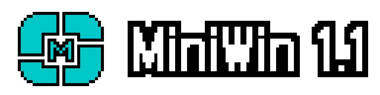
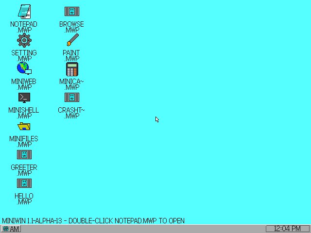

<p align="center">
  
</p>

# MiniWin

**Mini OS, Many Things.**

A dependency-free 32-bit x86 desktop OS that boots from a single MBR
disk image straight into a Windows-95-flavored GUI: real mode → protected
mode by hand, a from-scratch VGA/mouse/keyboard stack with its own disk
drivers (IDE, SATA/AHCI, SCSI, NVMe), and a windowing system with no libc, no
bootloader framework, and no borrowed kernel code.

**Current version: 1.1-alpha-14** ([changelog](docs/en/project/CHANGELOG.md)). Developed and
tested on QEMU; for VMware / VirtualBox see
[docs/en/user/VIRTUAL-MACHINES.md](docs/en/user/VIRTUAL-MACHINES.md).

**Other languages:** [한국어 (Korean)](README_ko.md) · documentation in Korean: [docs/ko/README.md](docs/ko/README.md)

**Documentation:** [docs/en/README.md](docs/en/README.md) -- guides for people who run MiniWin
([getting started](docs/en/user/GETTING-STARTED.md), [troubleshooting](docs/en/user/TROUBLESHOOTING.md), [FAQ](docs/en/user/FAQ.md)) and for
people who change it ([architecture](docs/en/dev/ARCHITECTURE.md), [source map](docs/en/dev/SOURCE-MAP.md),
[contributing](docs/en/dev/CONTRIBUTING.md)).



## What's in here

Everything below runs from **one 1.44 MB disk image** (`build/os-image.img`) in a virtual machine. Nothing is borrowed: no libc, no bootloader
framework, no kernel code from another system. [docs/en/dev/ARCHITECTURE.md](docs/en/dev/ARCHITECTURE.md) is the tour; every file is described in
[SOURCE-MAP.md](docs/en/dev/SOURCE-MAP.md).

**Boot and hardware**
- A 512-byte MBR and a second-stage loader (real mode → protected mode by hand, A20, GDT, a real VBE true-colour mode found through the BIOS). Every
  boot failure has a code and a name (`MW-B01` ... `MW-K10`, table in [BOOT-PROCESS.md](docs/en/dev/BOOT-PROCESS.md)).
- Screen: 32-bit true colour at **640x480** (or **854x480** or **320x200**, chosen in Display Properties and remembered across restarts).
- Disks: IDE/ATA and ATAPI, **SATA (AHCI)**, **LSI SCSI**, **NVMe** and the boot floppy, found by themselves from the disk MiniWin booted from;
  PCI enumeration; ACPI power off; a CPU-exception handler that shows a named error screen; a COM1 debug log.
- Input: PS/2 and **USB** (xHCI, EHCI, OHCI: keyboard, wheel mouse, tablet).
- Network: Intel e1000 family and RTL8139 cards, polled; ARP, IPv4, ICMP, UDP, DHCP, DNS, TCP.
- **TLS 1.3 and 1.2** and **HTTP/3 over QUIC**, with every primitive written here (SHA-2, AES-GCM, X25519, P-256/P-384, RSA/ECDSA, X.509 chain
  validation against a built-in trust store of 198 roots taken from Mozilla's bundle, hostname and date checks).

**The file system**
- **MWFS**, MiniWin's own: directories without a depth limit, files that grow, `/` plus other disks under `/mnt/<id>`, a free-space bitmap, a CRC-32 per
  file, and **crash safety by construction** (a new file is written whole before one directory write switches the name; tested with a power cut after
  every sector write of every operation). A Unix-like tree (`/boot /dev /etc /bin /lib /sys /proc /var /home /progs ...`), where the system folders can
  only be changed by `root`. `part` formats, mounts, checks and edits partitions; `os-inst` installs MiniWin onto another disk or partition.

**The desktop** (a Windows-95-flavoured GUI; the look can be changed at build time with `THEME=...`)
- Real overlapping windows: drag, resize from the edges (the cursor shows which way), minimize, maximize, a task bar with a button for every window,
  a Start menu with folders (`/home/start`) and an *Add...* wizard, a clock with a calendar, **right-click menus**, scroll bars you can drag, the wheel.
- **Dialogs are windows too** -- Notepad's "Save changes?", Save As and Help boxes, MiniWeb's About box, "Keep this screen size?", the Fonts questions and
  Add Fonts: drag them by the title bar, `_ [] X`, a task bar button each; their owner window is disabled until they are answered
  ([DIALOGS.md](docs/en/dev/DIALOGS.md)).
- First start: a setup wizard (language, licence, your account, final settings) and a **logon** prompt; passwords for `root` and the user.
- Text in a real **Hangul** IME (2-beolsik) and a bitmap font of all 11,172 modern syllables (Galmuri), installable **TrueType fonts** (`Fonts` folder,
  *Install New Font...*), sizes 7 to 14, kerning. The whole interface switches between English and Korean at once.

**Apps** (each is a `.MWP`)
- **NOTEPAD** -- several documents, each in its own window, saved on the disk.
- **SETTING** (the Control Panel) -- Display Properties, Date/Time, Mouse (pointer pictures and speed), Fonts, Keyboard/IME, Regional, Sounds, System, Power.
- **MINIWEB** -- a small browser with an address bar, history, HTTPS and HTTP/3, and its own **HTML5 / CSS3 / JavaScript** engine, images
  (PNG, JPEG, GIF) and a right-click menu.
- **MINISHELL** -- a terminal with Unix/Windows-style commands (`ls cd cp mv rm mkdir cat part os-inst fetch lsusb run ...`), `root` and `user`.
- **MINIFILES** -- a file manager (copy, cut, paste, rename, delete, drives, installing MiniWin onto a disk).
- Examples that ship on the image: **TETRIS**, **MINES** (Minesweeper), **BROWSE**, **PAINT**, **MINICALC**, **GREETER**, **HELLO**, **RING3**, **CRASHTST**.

**Programs and the SDK**
- Programs are `.MWP` files: compiled apart from the kernel, kept on the disk, loaded by the OS, talking to it through a fixed system-call table.
  A program built with `--ring3` runs in **ring 3** (protected user mode) and cannot touch the kernel.
- **SDK 3.0** (`sdk/`, [sdk/README.md](sdk/README.md)): `miniwin.h` (API v4), `mw_libc.h` (strings, `mw_snprintf`, a heap with `mw_malloc`/`mw_free`,
  `mw_rand`, `mw_qsort`, ...), `mw_gfx.h`, the `mw_ui.h` widget toolkit, build and install scripts, and examples from `hello.c` up to a whole Tetris and
  Minesweeper. A program may be 60 KB.

## What is not there (yet)

MiniWin is an **alpha**, a hobby and teaching system, not something to run your day on. It has only been run on QEMU. Plainly:
no USB storage and no USB hubs; legacy BIOS only (no UEFI); IPv4 only; a single CPU and no scheduler (one program at a time, the kernel polls everything);
no sockets API; documents are limited to 4 KB (Notepad's buffer); MiniWeb is a small engine, not a general browser (no cookies yet, no WebP/SVG, parts of
CSS3 and JavaScript are missing). The honest, complete list and what comes next -- process protection, USB flash drives, FAT/ext readers, a scheduler, IPv6, ... --
is in [ROADMAP.md](docs/en/project/ROADMAP.md).

## Building

You need `nasm`, a `gcc` that can build 32-bit code (on a 64-bit Debian/Ubuntu: `gcc-multilib`), `ld`, and `python3` with Pillow (`python3-pil`).

```bash
./build.sh && tools/install_all.sh                 # the second step puts the icons and the demo programs on the image
./build.sh && tools/install_all.sh --no-demos      # without GREETER and the SDK examples (an empty /progs)
THEME=dark ./build.sh && tools/install_all.sh      # another look (kernel/ui/themes/<name>.h)
```

`install_all.sh` makes the two images to hand out: **`build/os-image.iso`** (the default: the whole system as a live disk, at most 5 MB; boot it and
double-click INSTALL at the bottom right to put it on a disk) and **`build/os-image-floppy.img`** (the minimal system on a 1.44 MB floppy image, for the
"floppy image file" of VMware / VirtualBox). `build/os-image.img` itself is exactly **1440 KB** (1,474,560 bytes = 2880 sectors, one 1.44 MB floppy).
`build.sh` takes the boot budget and the storage layout from the same constants as `boot/boot.asm` and `kernel/fs.h` and fails loudly -- it does not
carry on -- when the kernel's `.bss` would meet the boot stack, the kernel outgrows the loader's read budget, the kernel, the icon catalogue and the root
file system overlap, or the image does not end exactly where it should. The `build/` directory is not in git, and there are no prebuilt downloads of the
current version.

## Running

```bash
qemu-system-i386 -drive file=build/os-image.img,format=raw
```

To **hear** the PC-speaker beep (Notepad's unsaved-changes warning) give QEMU an audio backend: add
`-audiodev pa,id=snd0 -machine pcspk-audiodev=snd0` (`dsound`, `coreaudio` or `sdl` instead of `pa` on other platforms; `qemu-system-i386 -audio-help` lists them).
With a network card and a serial log: `-netdev user,id=n0 -device rtl8139,netdev=n0 -serial file:serial.log` (`-nic user,model=e1000` works too).
The same image boots from IDE, AHCI (`-device ich9-ahci`), a floppy (`build/os-image-floppy.img`, `-drive if=floppy -boot a`), SCSI (`-device mptsas1068`)
and NVMe (`-device nvme`). VMware / VirtualBox: [VIRTUAL-MACHINES.md](docs/en/user/VIRTUAL-MACHINES.md).

## Controls

- Mouse: click, drag a title bar or an edge, `_` / `[]` / `X`, right-click for menus, the wheel scrolls.
- **Right Alt** switches the input language (only the ones switched on in SETTING > Keyboard > IME take part).
- In Notepad **Ctrl+S / Ctrl+N / Ctrl+W**: save / new document / close.
- Tetris: arrows move and turn, Space drops, P pauses, R restarts. Minesweeper: left click opens, right click flags, the face starts a new game.

## Project layout

```
boot/            the 512-byte MBR and the second-stage loader
kernel/          the OS: kernel.c (the map of the layers and the main loop) and one header per subsystem
  ui/            the shell: theme, widgets, windows, task bar, Start menu, dialogs (dialog.h), input
  apps/          Notepad, Setting, MiniWeb (web/), MiniShell, MiniFiles, the program windows
  sys/           util, language and IME, power, boot
  usb/           xHCI / EHCI / OHCI and the HID keyboard, mouse and tablet
programs/        .mwp programs built apart from the kernel (greeter, ...)
sdk/             SDK 3.0 for people who write programs: include/, examples/, build.sh, install.sh
tools/           build, install and generator scripts; tools/test/ holds the tests (host tests, QEMU tests, screenshot goldens)
docs/            en/ (the complete docs), ko/ (Korean), logo/
third_party/     the font and icon sources with their licences
```

The tests are described in [TESTING.md](docs/en/dev/TESTING.md); `tools/test/check_docs.py` and `check_version.sh` keep the docs honest.

## The name: MWP

Every app here is a `.mwp` file -- "**M**ini**W**in **P**rogram". Notepad, Setting, MiniWeb, MiniShell and MiniFiles were written before the loader existed,
so they live inside the kernel and only carry the name; GREETER, Tetris and the other programs of `programs/` and `sdk/examples/` are the real loadable
kind (`kernel/mwp.h`, [MWP-PROGRAMS.md](docs/en/dev/MWP-PROGRAMS.md)).

## License

MiniWin is free software, licensed under the **GNU General Public License,
version 3** (`GPL-3.0-only`) -- the full text is in `LICENSE`, and every
source file of the project carries an `SPDX-License-Identifier:
GPL-3.0-only` line.

    MiniWin -- a 32-bit x86 operating system
    Copyright (C) 2026 MiniWin Project

    This program is free software: you can redistribute it and/or modify
    it under the terms of the GNU General Public License version 3 as
    published by the Free Software Foundation.

    This program is distributed in the hope that it will be useful, but
    WITHOUT ANY WARRANTY; without even the implied warranty of
    MERCHANTABILITY or FITNESS FOR A PARTICULAR PURPOSE.  See the GNU
    General Public License for more details.

    You should have received a copy of the GNU General Public License
    along with this program.  If not, see <https://www.gnu.org/licenses/>.

The **icon pack** (`third_party/icon-bundle/`, also written into the icon
catalog of every disk image) and the **logo** (`docs/logo/`) are *not* GPL: they are licensed
**CC BY-SA 4.0** by its author, SegFault777 -- credit the author and share
adaptations alike (<https://creativecommons.org/licenses/by-sa/4.0/>). Code and
artwork are separate works under separate licenses, distributed together on the
disk image.

Bundled third-party material keeps the license of its own authors (the
Galmuri and Dalmoori fonts, the CA root certificates, and the data files
generated from them); see `third_party/*/NOTICE.md` and
[docs/en/project/LICENSING.md](docs/en/project/LICENSING.md) for the full picture, including
what changed from the earlier MIT-licensed versions.
