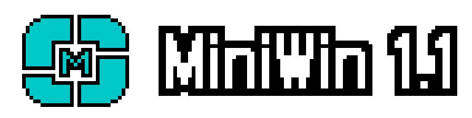
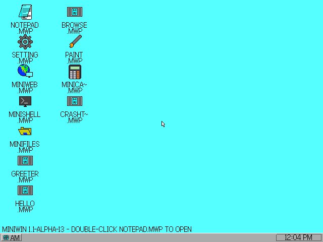

<p align="center">
  
</p>

# MiniWin

**Mini OS, Many Things.**

외부 의존성이 전혀 없는 32비트 x86 데스크톱 운영체제입니다. MBR 디스크 이미지 하나로 부팅해 곧바로 윈도우 95 느낌의 GUI가 뜹니다.
리얼 모드에서 보호 모드로 직접 넘어가고, VGA·마우스·키보드 스택과 자체 디스크 드라이버(IDE, SATA/AHCI, SCSI, NVMe)를 처음부터 만들었으며,
libc도 부트로더 프레임워크도 남의 커널 코드도 쓰지 않는 창 시스템을 갖췄습니다.

**현재 버전: 1.1-alpha-14** ([변경 내역](docs/en/project/CHANGELOG.md), 영어). QEMU에서 개발·시험했고,
VMware / VirtualBox는 [가상 머신 안내](docs/en/user/VIRTUAL-MACHINES.md)(영어)를 보세요.

**다른 언어:** [English](README.md) · 한국어 문서 목차: [docs/ko/README.md](docs/ko/README.md)



> 이 문서는 영어 [README.md](README.md)의 한국어판입니다. 세부 구현 설명(부트 과정, 디스플레이, 네트워크, HTML5 엔진 등)은 길어서
> 영어 README와 [개발자 문서](docs/en/dev/ARCHITECTURE.md)에 두고, 여기에는 무엇이 들어 있는지와 사용법을 간추려 적었습니다.

## 무엇이 들어 있나

- **부트**: 512바이트 MBR(`boot/boot.asm`)과 2단계 로더(`boot/stage2.asm`)가 BIOS 호출로 진짜 VBE 트루컬러 모드를 찾아 설정하고,
  보호 모드로 넘어가 INT 13h 확장(LBA) 읽기로 커널을 올립니다. 모든 부트 오류에는 코드와 이름이 있습니다(`MW-B01` … `MW-K10`,
  표는 [BOOT-PROCESS.md](docs/en/dev/BOOT-PROCESS.md)).
- **화면**: 640x480, 32비트 트루컬러. 24비트 RGB로 표현되는 모든 색을 팔레트 없이 그대로 씁니다.
- **커널**: libc 없는 독립 실행형 C. PS/2와 **USB**(xHCI·EHCI·OHCI: 키보드, 휠 마우스, 태블릿) 입력, PC 스피커 경고음,
  충돌에 안전한 파일 시스템 **MWFS**(깊이 제한 없는 디렉터리, `/` 아래 다른 디스크는 `/mnt/<id>`, 빈 공간 비트맵, 파일별 CRC-32),
  PCI 열거, IDE·ATAPI·SATA(AHCI)·SCSI·NVMe·플로피 드라이버, ACPI 전원 끄기, 이름 있는 오류 화면을 보여 주는 CPU 예외 처리기,
  COM1 직렬 디버그 로그.
- **데스크톱**: 끌고, 크기 바꾸고, 최소화·최대화할 수 있고 실제로 겹치는 창(클릭하면 앞으로), 모서리·가장자리에서 방향 화살표로 바뀌는 커서,
  **대화상자도 독립된 창**(메모장의 "저장할까요?"·다른 이름으로 저장·도움말, MiniWeb 정보, "이 화면 크기를 유지할까요?", 글꼴 질문, 글꼴 추가:
  제목 막대로 끌고, `_ □ X`, 작업표시줄 단추가 있으며, 질문이 열려 있는 동안 소유 창은 비활성 —
  [DIALOGS.md](docs/en/dev/DIALOGS.md)), 시작 메뉴(다시 시작/끄기 펼침 메뉴; 끄기는 ACPI로 실제 전원을 끕니다),
  최소화한 순서대로 늘어서는 작업표시줄, CMOS 실시간 시계(클릭하면 날짜).
- **앱**: NOTEPAD(여러 문서를 각자 창으로, 디스크에 저장), SETTING(언어 — UI 전체가 즉시 바뀝니다 —, 입력기, 시간대, 화면, 마우스, 소리,
  글꼴·자간, 정보, 전원), MINIWEB(주소창이 있는 작은 브라우저: DNS, TLS 1.2 인증서 체인 검증, HTTP/1.1, 직접 만든 **HTML5 엔진**),
  MINISHELL(터미널), MINIFILES(파일 관리자와 디스크 설치).
- **프로그램(.mwp)**: 커널과 따로 컴파일해 디스크에 두면 OS가 읽어 와 실행하는 작은 프로그램 형식입니다. 고정 주소의 시스템 호출 표로
  OS와 대화하며, 링 3(보호된 사용자 모드)로도 돌릴 수 있습니다.
- **SDK 3.0** (`sdk/`, [sdk/README.md](sdk/README.md)): 커널 소스 밖에서 MiniWin 프로그램을 짜는 데 필요한 모든 것 — `miniwin.h`(시스템 호출 표, API v4),
  `mw_libc.h`(문자열, `mw_snprintf`, `mw_malloc`/`mw_free`가 있는 힙, `mw_rand`, `mw_qsort` …), `mw_gfx.h`, `mw_ui.h` 위젯 도구, 빌드·설치 스크립트,
  `hello.c`부터 **테트리스**·**지뢰찾기**까지 예제(프로그램 크기 상한 60 KB).
- **한글**: 2벌식 자모 조합 입력기와 현대 한글 11,172자를 모두 담은 비트맵 글꼴(갈무리11에서 생성). 영문도 같은 글꼴이라 UI 전체가 한 서체입니다.
- **아이콘**(CC BY-SA 4.0, SegFault777 제작): 16x16/32x32 RGBA 아이콘 61종을 디스크의 아이콘 카탈로그에 설치합니다.

## 빌드

`nasm`, 32비트를 만들 수 있는 `gcc`(64비트 데비안/우분투라면 `gcc-multilib`), `ld`가 필요합니다.

```bash
./build.sh && tools/install_all.sh                 # 두 번째 단계가 아이콘과 데모 프로그램을 이미지에 넣습니다
./build.sh && tools/install_all.sh --no-demos      # GREETER와 SDK 예제 없이(빈 /progs)
THEME=dark ./build.sh && tools/install_all.sh      # 다른 모양(kernel/ui/themes/<이름>.h)
```

`install_all.sh`는 배포용 이미지 둘을 만듭니다. **`build/os-image.iso`**(기본값: 라이브 디스크로 쓰는 전체 시스템, 최대 5 MB; 부팅해서 오른쪽 아래
INSTALL을 더블클릭하면 디스크에 설치됩니다)와 **`build/os-image-floppy.img`**(1.44 MB 플로피 이미지에 담은 최소 시스템; VMware / VirtualBox의
"플로피 이미지 파일"용).

미리 빌드한 이미지는 옛 버전만 [GitHub Releases](../../releases)에 `<버전>-image.img`로 올라 있고, 새 버전은 소스로만 공개합니다.
`build/` 디렉터리는 git에 올라가지 않습니다.

`build/os-image.img`는 정확히 **1440 KB**(1,474,560바이트 = 2880섹터, 플로피 한 장)의 원시 디스크 이미지입니다. `build.sh`는 부트 예산과
저장소 배치를 `boot/boot.asm`·`kernel/fs.h`와 같은 상수에서 뽑아 쓰며, 커널 `.bss`가 부트 스택과 겹치거나 커널이 부트로더 읽기 예산을 넘거나
커널·아이콘 카탈로그·루트 파일 시스템이 겹치거나 이미지 끝에서 딱 맞지 않으면 조용히 넘어가지 않고 실패합니다.

## 실행

```bash
qemu-system-i386 -drive file=build/os-image.img,format=raw
```

PC 스피커 경고음(메모장의 저장 안 한 변경 경고)을 **듣고** 싶다면 QEMU에 오디오 백엔드를 직접 붙여야 합니다.

```bash
qemu-system-i386 -drive file=build/os-image.img,format=raw \
  -audiodev pa,id=snd0 -machine pcspk-audiodev=snd0
```

(`pa` 대신 `dsound`, `coreaudio`, `sdl` 등 플랫폼에 맞는 것을 쓰세요. `qemu-system-i386 -audio-help`로 목록이 나옵니다.)

같은 이미지가 IDE 디스크, AHCI SATA(`-device ich9-ahci`), 1.44 MB 플로피(`build/os-image-floppy.img`, `-drive if=floppy -boot a`),
LSI Logic SCSI(`-device mptsas1068`), NVMe SSD(`-device nvme`)에서 모두 부팅하며, 커널이 자신이 올라온 디스크를 스스로 찾습니다.
VMware·VirtualBox는 [VIRTUAL-MACHINES.md](docs/en/user/VIRTUAL-MACHINES.md)(영어)를 보세요.

네트워크 카드를 붙이려면:

```bash
qemu-system-i386 -drive file=build/os-image.img,format=raw \
  -netdev user,id=n0 -device rtl8139,netdev=n0 \
  -serial file:serial.log
```

## 조작

- 마우스: 클릭, 제목 막대 끌기, `_` / `□` / `X` 단추.
- **오른쪽 Alt**: 입력기 전환(SETTING > SYSTEM > IME에서 켠 언어만 돌아가며 선택됩니다).
- 메모장에서 **Ctrl+S / Ctrl+N / Ctrl+W**: 저장 / 새 문서 / 닫기.
- 테트리스: 방향키 이동·회전, 스페이스 하드 드롭, P 일시정지, R 다시 시작. 지뢰찾기: 왼쪽 클릭 열기, 오른쪽 클릭 깃발, 얼굴 클릭 새 게임.

## 프로젝트 구조(요약)

```
boot/            1단계 MBR(512바이트), 2단계 로더(VBE 모드 탐색, A20, GDT, 보호 모드)
kernel/          OS 본체: kernel.c(층 지도와 메인 루프) + 하위 시스템별 헤더
  ui/            데스크톱 셸: 테마, 위젯, 창·작업표시줄·시작 메뉴·대화상자(dialog.h)·입력
  apps/          앱: notepad, setting, web(MiniWeb), terminal(MiniShell), minifiles
  sys/           util, 언어·입력기, 전원, 부트
  usb/           xHCI / EHCI / OHCI와 HID 키보드·마우스·태블릿
programs/        커널과 따로 빌드하는 .mwp 소스 (greeter 등)
sdk/             프로그램을 짜는 쪽의 SDK 3.0: include/, examples/, build.sh, install.sh
tools/           빌드·설치·생성 스크립트와 tools/test/ 시험들
docs/            문서: docs/en/(영어 전체), docs/ko/(한국어), docs/logo/
third_party/     글꼴·아이콘 원본과 각각의 라이선스
```

파일 하나하나의 설명은 [SOURCE-MAP.md](docs/en/dev/SOURCE-MAP.md)(자동 생성), 구조는 [ARCHITECTURE.md](docs/en/dev/ARCHITECTURE.md)에 있습니다.

## 프로젝트 이름: MWP

여기 있는 모든 앱은 `.mwp`("**M**ini**W**in **P**rogram") 파일입니다. NOTEPAD·SETTING·MINIWEB·MINISHELL·MINIFILES는
적재 가능한 프로그램 로더보다 먼저 만들어져 지금은 커널에 들어 있지만 같은 `.mwp` 이름을 씁니다. GREETER, 테트리스처럼 따로 컴파일한 프로그램이
진짜 적재형입니다. 로더는 `kernel/mwp.h`, 예제는 `sdk/examples/`를 보세요.

## 로드맵과 알려진 한계

지금 상태와 앞으로의 계획은 [ROADMAP.md](docs/en/project/ROADMAP.md)(영어)에 정직하게 적어 두었습니다.

## 라이선스

MiniWin은 자유 소프트웨어이며 **GNU 일반 공중 사용 허가서 3판**(`GPL-3.0-only`)으로 배포됩니다. 전문은 `LICENSE`(한국어 안내: `LICENSE.ko.txt`)에 있고,
프로젝트의 모든 소스 파일에 `SPDX-License-Identifier: GPL-3.0-only` 줄이 들어 있습니다.

**아이콘 묶음**(`third_party/icon-bundle/`, 모든 디스크 이미지의 아이콘 카탈로그에도 들어갑니다)과 **로고**(`docs/logo/`)는 GPL이 아니라
저작자 SegFault777의 **CC BY-SA 4.0**입니다 — 저작자를 밝히고 같은 조건으로 공유하세요
(<https://creativecommons.org/licenses/by-sa/4.0/deed.ko>). 코드와 그림은 서로 다른 라이선스의 별개 저작물이며 디스크 이미지에 함께 담겨 배포됩니다.

함께 들어 있는 제3자 자료(갈무리·달무리 글꼴, CA 루트 인증서와 그로부터 만든 데이터 파일)는 각 저작자의 라이선스를 따릅니다.
`third_party/*/NOTICE.md`와 [LICENSING.md](docs/en/project/LICENSING.md)를 보세요.
